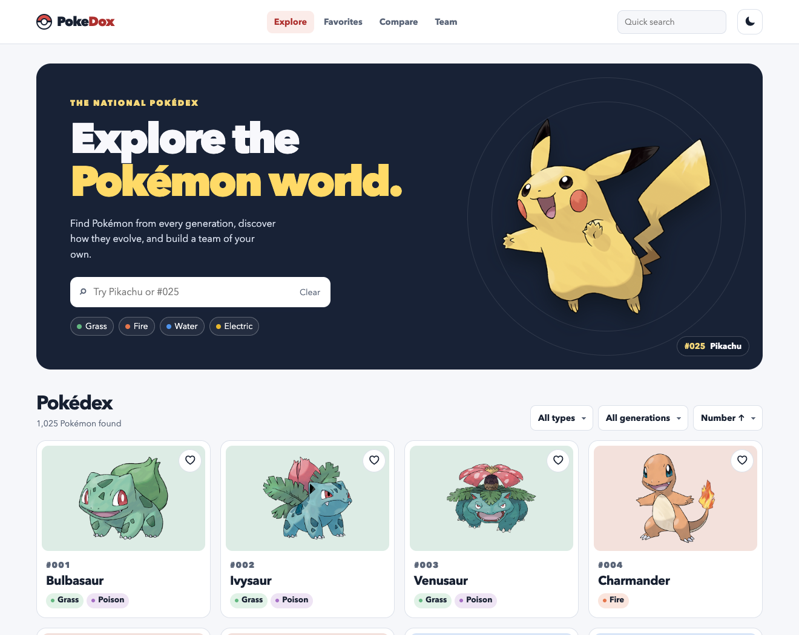

# PokeDox

PokeDox is a browser-based Pokémon encyclopedia. Search the National Pokédex by name or number, filter by type and generation, and open entries for statistics, abilities, evolution families, and defensive type matchups. Compare two Pokémon or build a team of up to six. Favorites, the team, recently viewed entries, and the theme preference are saved in the current browser.
🌐 **Live Site:** [PokeDox](https://nick-vns.github.io/js-pokedex/)

## Screenshots



[View the mobile comparison in dark mode](docs/screenshots/compare-mobile.png)

## Requirements

- Node.js **22.13 or later in the 22.x line**, or **24 or later**. Node.js 24 LTS is a good default.
- npm 10 or later. npm comes with the official Node.js installer.
- A modern web browser and internet access to load Pokémon data and artwork.

Check your versions in Terminal with `node -v` and `npm -v`. If either command is missing, install Node.js, reopen Terminal, and check the versions again. [Node.js downloads](https://nodejs.org/en/download)

## Run locally

Open Terminal in the repository folder, where `package.json` lives, and run:

```sh
npm ci
npm run dev
```

Open the **Local** address that Vite prints, usually `http://localhost:5173/`. A successful start shows the PokeDox catalog. If port 5173 is busy, use the port printed by Vite. If npm reports a missing `package.json`, change to the repository folder and try again. Press **Ctrl+C** in Terminal to stop the server.

## Check and build

```sh
npm run lint
npm test
npm run build
npm run preview
```

The tests cover search and sorting, combined filters, evolution conditions, type matchups, saved state, and API caching and errors. The production build writes to `build/`. Open the **Local** address from the preview command to test the built files. Try opening a detail route such as `/pokemon/pikachu` and refreshing the page.

## Data and environment variables

PokeDox uses the public PokéAPI v2 REST endpoints at `https://pokeapi.co/api/v2/`. It fetches a lightweight species index for search and loads full Pokémon data only for visible cards or requested entries. The browser session shares pending and completed API requests. The catalog shows National Pokédex species and their default forms. [PokéAPI documentation](https://pokeapi.co/docs/v2)

Pokémon artwork is sourced from the PokéAPI sprites repository. Favorites, team, recent history, and theme are specific to the current browser and site address. Clearing site data removes them. [PokéAPI sprites](https://github.com/PokeAPI/sprites)

No environment variables or API key are required.

## Deploy to GitHub Pages

1. On GitHub, open the repository and go to **Settings → Pages → Build and deployment**. Select **GitHub Actions** as the source. This lets the workflow build the app before publishing it. [GitHub Pages setup](https://docs.github.com/en/pages/getting-started-with-github-pages/configuring-a-publishing-source-for-your-github-pages-site#publishing-with-a-custom-github-actions-workflow)
2. Merge the changes into `main` to trigger the deployment. If the changes are already on `main`, use **Actions → Deploy PokeDox to GitHub Pages → Run workflow**.
3. Open the completed workflow and click the deployment URL. For this repository, the expected address is `https://nick-vns.github.io/js-pokedex/`. Open a Pokémon, copy its URL, and load it in a new tab. Pages links look like `/js-pokedex/#/pokemon/pikachu` and support direct visits and refreshes.

If the workflow can't configure Pages, check that **GitHub Actions** is selected as the publishing source. The workflow gets the site's base path from GitHub, so project sites and custom domains use the same build process.

To preview the GitHub Pages build locally:

```sh
npm run build -- --mode github-pages --base /js-pokedex/
npm run preview -- --mode github-pages --base /js-pokedex/
```

## Deploy to Vercel

1. Push this repository and its lockfile to a Git provider connected to your Vercel account. Vercel uses the branch you import as its build source.
2. In the Vercel dashboard, choose **Add New → Project**, select the repository, and click **Import**. Select the **Vite** preset and choose the folder containing `package.json` as the root directory.
3. Use Node.js 24.x in **Settings → Build and Deployment** if you need to select a version. The repository config uses `npm ci` to install, `npm run build` to build, and `build` as the output directory. Leave the environment variables section empty.
4. Click **Deploy**. A successful deployment shows **Ready** and a site URL. Open it and visit `/pokemon/pikachu` directly, then refresh. A detail-page 404 usually means the deployment missed `vercel.json` or used the wrong root directory. That file supplies the rewrite for client-side routes. [Vercel Vite deployment guide](https://vercel.com/docs/frameworks/frontend/vite)

## Project structure

| Location | Purpose |
| --- | --- |
| `index.html`, `src/scripts.js` | Application shell, client-side routes, and shared state |
| `src/api.js` | PokéAPI resource requests, validation, and session cache |
| `src/explore.js`, `src/detail.js`, `src/collections.js` | Catalog, Pokémon detail, saved collections, and comparison |
| `src/ui.js`, `src/styles.css` | Shared UI components and responsive themes |
| `src/catalog.js`, `src/storage.js` | Filtering, sorting, evolution and matchup helpers, and persistence |
| `test/` | Automated tests using Node's built-in test runner |
| `vercel.json` | Static build settings and route fallback |

The original static version loaded Bootstrap 4.3.1, jQuery 3.3.1, and Popper 1.14.7 from CDNs and bundled Promise and Fetch polyfills. The current app retains plain JavaScript and CSS, uses Vite for development and builds, and runs without third-party JavaScript dependencies in the browser. The legacy `dist/` files are outside the current build.
